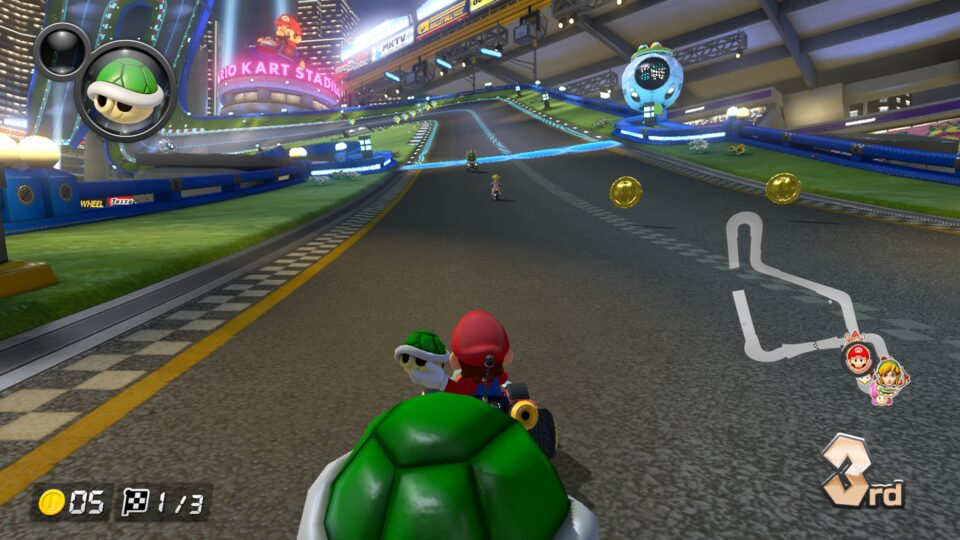
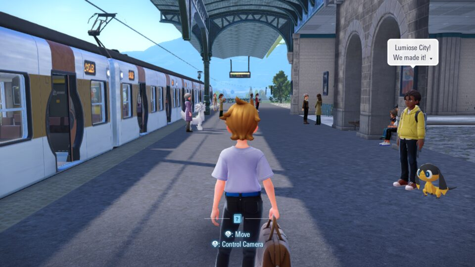
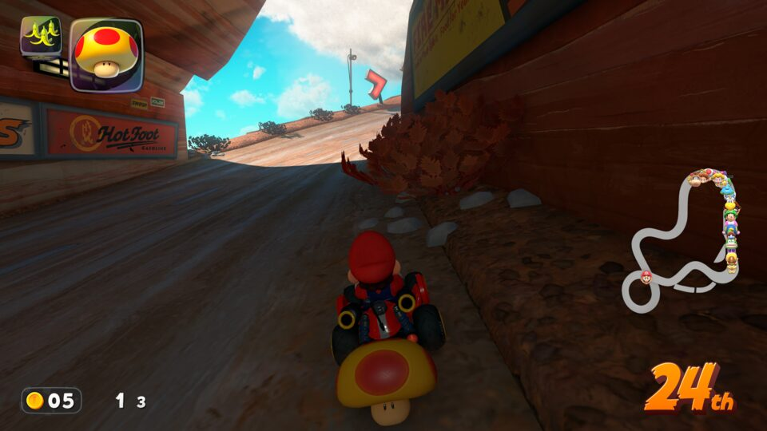

# nxrs

A Rust static recompiler and launcher for Switch and Switch 2 games. Add your NSP, NUP or game dump, build, play.


## Features

**Library**
- Add games from NSP, NUP, XCI or extracted game folders; box art, gallery or list view, search, filter and sort.
- One click to build, one click to play. Build progress and logs in the build-output panel.
- Updates and DLC: install update and DLC packages, choose which version to build.
- Per-game settings: docked or handheld, Switch or Xbox button layout, artwork, compiler workers.
- Built-in checks that your PC has what a build needs (compiler, Vulkan, keys, disk space).

**In game**
- Native x86-64 code (no emulation of the CPU), Vulkan graphics.
- Controllers: Xbox, DualSense / DualShock 4, Switch Pro and Joy-Con, with rumble and motion.
- F1 controls page · F3 screenshot · F4 FPS limit · F6 cheats · F7 record video · F11 fullscreen.
- Game mods and cheats, saves kept per game.

## Games

Captured from nxrs builds of each game. FPS is the average over a stretch of scripted gameplay (with the slowest 5% of
seconds in brackets), measured at 1080p docked on a GeForce RTX 5090 and Core Ultra 9 285K.

| | | |
|---|---|---|
| <br>**Super Mario Bros. Wonder**<br>60.1 FPS (59.4) | <br>**Donkey Kong Bananza**<br>59.4 FPS (53.4) | <br>**Mario Kart 8 Deluxe**<br>59.8 FPS (58.0) |
| <br>**Pokémon Legends: Z-A**<br>59.6 FPS (57.9) | <br>**Super Mario Party Jamboree**<br>56.0 FPS (36.5) | <br>**Mario Kart World**<br>22.9 FPS (19.0), in progress |
| <br>**Pokémon Legends: Arceus**<br>30.0 FPS (29.5), the game's own 30 FPS cap | <br>**Anime Girls: Sun of a Beach**<br>60.0 FPS (59.8) | <br>**Beach Bounce Remastered**<br>60.0 FPS (59.1) |

Not working yet: The Legend of Zelda: Ocarina of Time, Pokémon Violet, SONIC X SHADOW GENERATIONS (Shadow) and Super
Smash Bros. Ultimate have open issues.

## Getting started

**You need:** Windows 10/11 x64 with an AVX2 CPU (x86-64-v3), a Vulkan GPU, [LLVM/clang](https://releases.llvm.org/),
the Visual Studio C++ build tools, and your own Nintendo keys (`prod.keys`) and game dumps. nxrs ships no games or keys.

1. Start `nxrs.exe`. **Keys > Install keys** and pick your `prod.keys`.
2. **Add game** and pick an NSP, NUP, XCI or game folder.
3. **Build**: the first build of a game takes a few minutes; later ones reuse what was built.
4. **Play.**

## Building from source

Rust (stable), the Vulkan SDK, LLVM and the Visual Studio C++ build tools:

```powershell
scripts/build/build.ps1 -Run     # builds the engine and launcher into dist/nxrs and starts it
```

`dist/nxrs` is the complete app (`nxrs.exe` plus `nxrs-engine/`). For developers: `AGENTS.md` and
`docs/ARCHITECTURE-AND-STYLE-GUIDE.md` describe the layout and rules.

## Credits

nxrs builds on the work of mkw-recomp, LAS Recomp, totk-pc-recomp, nxnative, Ryujinx, MacNativeGames, deko3d, lsfg-vk,
lztans, dav1d, libvpx, libopus, lewton, cpal and llvm-mingw. Thank you. Their licenses are in [`LICENSES/`](LICENSES/).

nxrs is MIT licensed ([LICENSE](LICENSE)). It is not affiliated with Nintendo.
