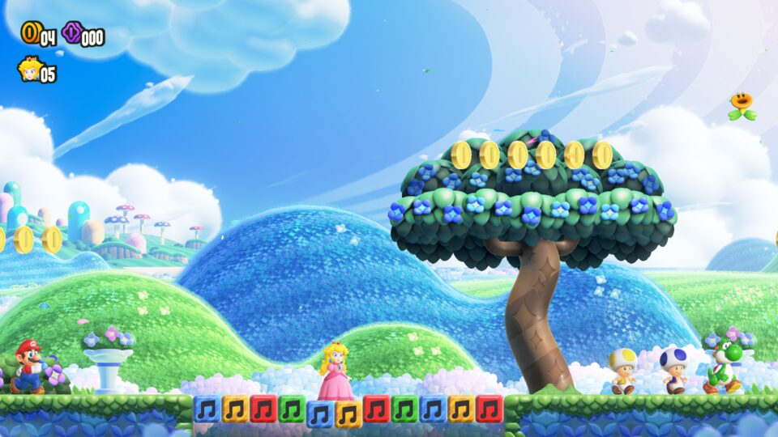
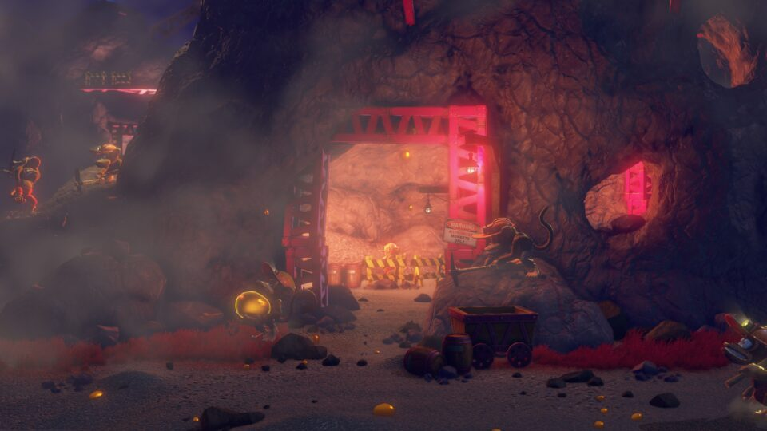
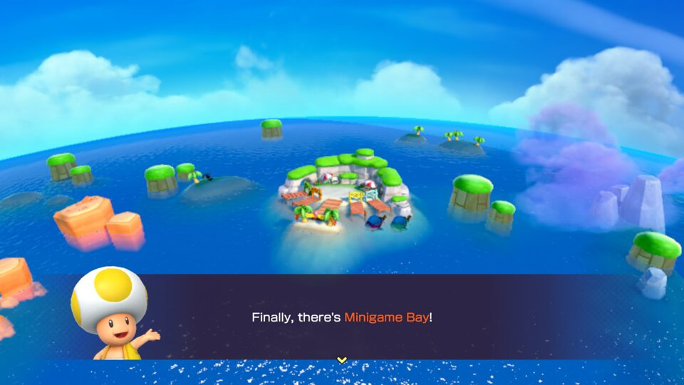
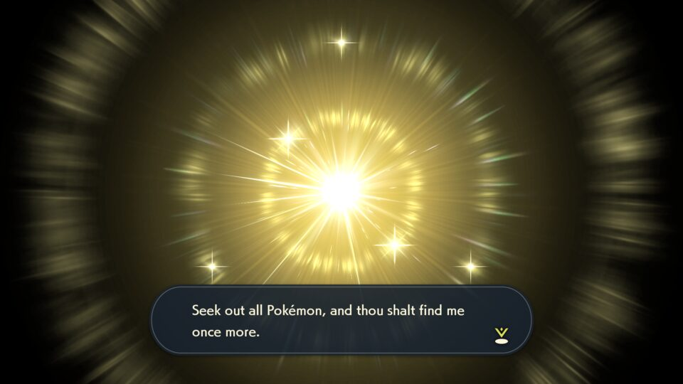
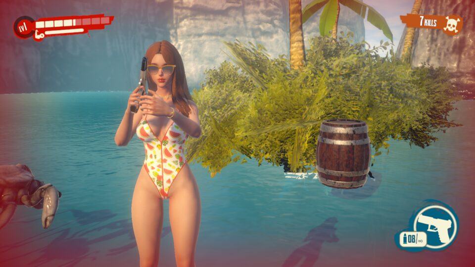
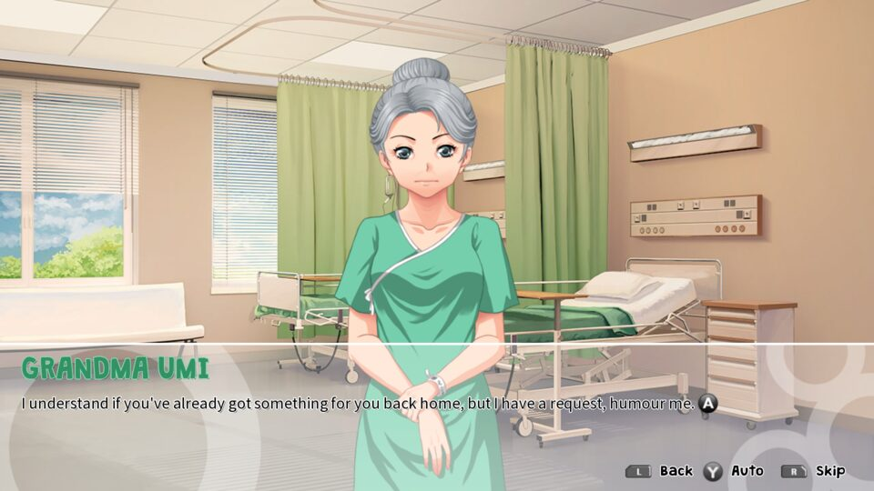

# nxrs

[](https://github.com/ChrisColeTech/nxrs/actions/workflows/ci.yml)
[](https://github.com/ChrisColeTech/nxrs/actions/workflows/launcher.yml)
[](LICENSE)

A Rust static recompiler and launcher for Switch and Switch 2 games. Add your NSP, NUP or game dump, build, play.

> [!IMPORTANT]
> No games, keys or firmware are included. Use your own legally obtained dumps and console keys.


## Install

1. Download `nxrs-windows-x64.zip` from the [latest release](https://github.com/ChrisColeTech/nxrs/releases/latest).
2. Unzip it anywhere and run `nxrs.exe`. Nothing else is installed; the folder is the whole app.
3. Install [LLVM](https://github.com/llvm/llvm-project/releases) and the
   [Visual Studio Build Tools](https://visualstudio.microsoft.com/visual-cpp-build-tools/) ("Desktop development with
   C++"). nxrs uses them to build each game. **Settings > Engine** checks your PC and tells you if anything is missing.

You need Windows 10 or 11 (64-bit), a CPU with AVX2 and a graphics card with Vulkan.

## Build from source

With [Rust](https://rustup.rs/), the [Vulkan SDK](https://vulkan.lunarg.com/), LLVM and the Visual Studio Build Tools:

```powershell
git clone https://github.com/ChrisColeTech/nxrs
cd nxrs
scripts/build/build.ps1 -Run
```

The app is built into `dist/nxrs` and started.

## Getting started

1. **Add game** and choose an NSP, NUP, XCI or extracted game folder.
2. For NSP games, install your keys once: **Keys > Install keys** and pick your `prod.keys`.
3. Press **Build**. The first build of a game takes a few minutes.
4. Press **Play**.

Updates and DLC are added from the game's menu; choose which version to build there too.

## Games

FPS is the average during gameplay, with the slowest 5% in brackets.

| | | |
|---|---|---|
| <br>**Super Mario Bros. Wonder**<br>60.1 FPS (59.4) | <br>**Donkey Kong Bananza**<br>59.4 FPS (53.4) | <br>**Mario Kart 8 Deluxe**<br>59.8 FPS (58.0) |
| <br>**Pokémon Legends: Z-A**<br>59.6 FPS (57.9) | <br>**Super Mario Party Jamboree**<br>56.0 FPS (36.5) | <br>**Mario Kart World**<br>28.8 FPS (25.0) |
| <br>**Pokémon Legends: Arceus**<br>30.0 FPS (29.5), the game's own cap | <br>**Anime Girls: Sun of a Beach**<br>60.0 FPS (59.8) | <br>**Beach Bounce Remastered**<br>60.0 FPS (59.1) |

**While playing:** Xbox, DualSense, DualShock 4, Switch Pro and Joy-Con controllers, with rumble and motion.
**F1** controls · **F3** screenshot · **F4** FPS limit · **F6** cheats · **F7** record video · **F11** fullscreen.

## Credits

Built on mkw-recomp, LAS Recomp, totk-pc-recomp, nxnative, Ryujinx and others; see [LICENSES](LICENSES/). nxrs is MIT
licensed and not affiliated with Nintendo.
