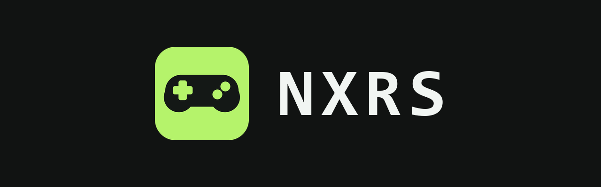

<p align="center">
  <a href="https://nxrs.app"></a>
</p>

<p align="center">Turn your Switch games into native PC games, or into web games that run in your browser.</p>

<p align="center">
  <a href="https://github.com/ChrisColeTech/nxrs/releases/latest"></a>
  <a href="https://nxrs.app"></a>
  <a href="https://github.com/ChrisColeTech/nxrs/actions/workflows/ci.yml"></a>
  <a href="LICENSE"></a>
</p>

<p align="center">
  <a href="#install">Install</a> •
  <a href="#getting-started">Getting started</a> •
  <a href="#build-from-source">Build from source</a> •
  <a href="#credits">Credits</a>
</p>

<!-- hero.gif: library → Build native/web → native and web launching to MK8D's title (coming) -->

> [!IMPORTANT]
> No games, keys or firmware are included. Use your own legally obtained dumps and keys.

## Key features

- **Recompiled, not emulated.** Each game is translated to native code ahead of time.
- **Native or web.** Build a Windows or Linux program, or a WebAssembly build.
- **Bring your own games.** NSP, NUP, XCI or game folders, with updates and DLC.
- **Built in Rust,** from the translator to the runtime.

## Install

Download for Windows or Linux, unpack it anywhere and run nxrs. There is nothing else to install: the tools nxrs
builds games with come in the download.

| OS | Download |
|---|---|
| **Windows&nbsp;10&nbsp;/&nbsp;11** | [x64&nbsp;(.zip)](https://github.com/ChrisColeTech/nxrs/releases/latest/download/nxrs-windows-x64.zip) |
| **Linux** | [x64&nbsp;(.tar.gz)](https://github.com/ChrisColeTech/nxrs/releases/latest/download/nxrs-linux-x64.tar.gz) |

You need a 64-bit PC (a CPU with AVX2) with a Vulkan graphics card. Run `nxrs.exe` on Windows, `nxrs/nxrs` on
Linux. **Settings > Engine** checks your PC.

## Getting started

1. **Add game** and choose an NSP, NUP, XCI or game folder.
2. For NSP games, install your keys once: **Keys > Install keys** and pick your `prod.keys`.
3. Press **Build**. The first build of a game takes a few minutes.
4. Press **Play**.

Add updates and DLC, and choose which version to build, from the game's menu.

## Build from source

With [Rust](https://rustup.rs/), the [Vulkan SDK](https://vulkan.lunarg.com/), LLVM and the Visual Studio Build Tools:

```powershell
git clone https://github.com/ChrisColeTech/nxrs
cd nxrs
scripts/build/build.ps1 -Run
```

This builds the app into `dist/nxrs` and starts it.

## Credits

Built on mkw-recomp, LAS Recomp, totk-pc-recomp, nxnative, Ryujinx and others; see [LICENSES](LICENSES/). HD rumble
uses Three-Dola's RenHDrum 0.5.0 (MIT OR Apache-2.0, used under MIT; `src/os/third_party/renhdrum/`). nxrs is MIT
licensed and not affiliated with Nintendo.

Games, compatibility and more at [nxrs.app](https://nxrs.app).
